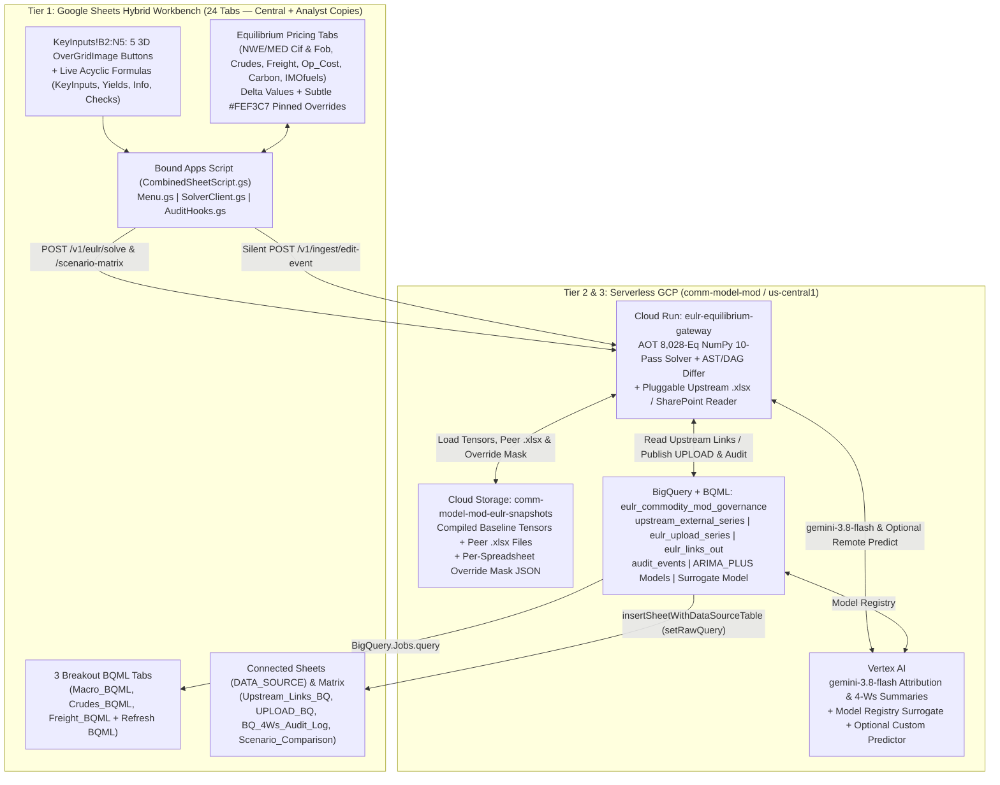
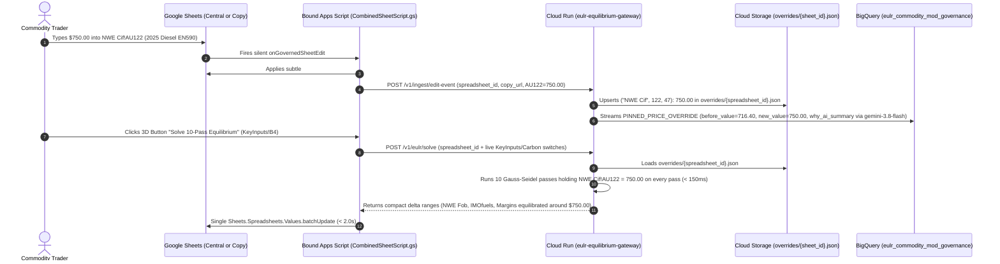

# System Design Document (SDD): European Long-Range Crude & Refined Products Price & Margin Model (`Eulr202409.xlsx`) — Google Sheets & Google Cloud Edition

| Metadata | Details |
| :--- | :--- |
| **Document Version** | 2.0 (Validated Serverless Architecture — `comm-model-mod` / `us-central1`) |
| **Target Workbook** | `Eulr/seed/Eulr202409.xlsx` (`20` Sheets, `604,453` `<c>` Cells, `357,708` Formulas $\rightarrow$ `8,028` Vectorized Row Equations, `iterateCount=10`) |
| **Companion PRD** | [`01_PRD_Eulr_Google_Sheets.md`](./01_PRD_Eulr_Google_Sheets.md) |
| **Target GCP Resources** | Project: `comm-model-mod` (`us-central1`) \| Cloud Run: `eulr-equilibrium-gateway` \| BigQuery: `eulr_commodity_mod_governance` \| GCS: `gs://comm-model-mod-eulr-snapshots` \| Vertex AI: `gemini-3.8-flash` + Model Registry (`eulr-sheets-mod-margin-surrogate`) |

---

## 1. Executive Architectural Overview

`Eulr202409.xlsx` is a multi-hub refinery economics and refined-product pricing equilibrium model covering **Northwest Europe (`NWE`)** and the **Mediterranean (`MED`)** on **CIF** and **FOB** bases (`1982–2050+`). Unlike acyclic spreadsheets, it relies on **10-pass iterative circular calculation (`iterate="1"`, `iterateCount="10"`)** across `13` coupled worksheets (`3.57M` cell evaluations per solve), `6,745` `{=CSE}` array formulas, and `14,162` external SharePoint workbook cells.

To deliver sub-2-second interactive speed, transparent in-sheet formulas, SharePoint portability, and zero-friction governance—while keeping `brazil-power-v13` untouched—our design applies four core patterns:

1. **Hybrid Google Sheets Formula Split + 3D `OverGridImage` Execution Deck (`KeyInputs!B2:N5`):**
   - Retains acyclic, non-external formulas natively in Google Sheets across `KeyInputs`, `Yields`, `Info`, and `Checks` (`~6,000+` live formulas), while offloading circular pricing sheets, `Op_Cost` `{=CSE}` arrays, and `UPLOAD`/`Links out` staging to Cloud Run and BigQuery.
   - Replaces fragile HTML5 sidebars with programmatic **3D bevel `OverGridImage` cell buttons** on `KeyInputs!B2:N5` and on the 3 BQML tabs (`Macro_BQML`, `Crudes_BQML`, `Freight_BQML`).
2. **AOT-Compiled Vectorized 10-Pass Engine + Delta `Values.batchUpdate` Sync:**
   - Build-time compilation transpiles all `8,028` R1C1 row equations into deterministic NumPy sheet kernels (`eulr_compiled_sheets.py`). Cloud Run solves all 10 Gauss-Seidel passes in `< 150 ms` and returns **only changed A1 range blocks** written in a single `Sheets.Spreadsheets.Values.batchUpdate` call (`< 2.0s` round-trip).
3. **SharePoint-Portable Upstream Link Registry (`UPSTREAM_SOURCE_MODE`):**
   - Preserves exact `(sharepoint_url, external_workbook_name, source_sheet, source_cell_a1, vintage_tag, link_health_tier)` metadata in `upstream_external_series`. Supports `eulr_baseline_cached` (for exact `<= 1e-8` parity), `peer_xlsx` (live ingestion of updated cells from `Uslr202409.xlsx`, `Felr202409.xlsx`, and `Tankerlr202409.xlsx` in Argolis), and `sharepoint_graph` (drop-in Microsoft Graph sync in S&P's tenant).
4. **100% Serverless Persistence, `#FEF3C7` Pinned Overrides & Silent Distributed `4-Ws` Governance:**
   - Eliminates always-on AlloyDB clusters: immutable `4-Ws` audit and override events stream to BigQuery (`audit_events`, `cell_overrides_history`), while active Pinned Override masks are stored per `spreadsheet_id` in Cloud Storage (`gs://comm-model-mod-eulr-snapshots/overrides/{spreadsheet_id}.json`), ensuring personal `File -> Make a copy` sheets stay completely isolated.

### 1.1 End-to-End Component & Data Flow Diagram



---

## 2. 10-Pass Vectorized Circular Equilibrium Solver (Pillar A)

### 2.1 Verified Sheet-Order Gauss-Seidel Execution Sequence

Inspection of `Eulr202409.xlsx` XML confirmed an active circular dependency chain through `ULSD-GO_spread_econs` (`NWE Cif -> ULSD-GO_spread_econs -> KeyInputs -> NWE Cif`). Therefore, the exact deterministic execution sequence on `/v1/eulr/solve` is:

```python
def solve_eulr_equilibrium(
    state: WorkbookTensorState,
    override_mask: dict[tuple[str, int, int], float],
    max_iterations: int = 10,
) -> EquilibriumSolveResult:
    # Step 1: Inject dynamic upstream_external_series, live sheet edits (KeyInputs, Carbon!A5:A6, Yields), and overrides
    apply_upstream_links_and_driver_edits(state)
    apply_pinned_overrides(state, override_mask)

    # Step 2: Pre-loop pure acyclic sheets
    evaluate_sheet_vectorized(state, "Info", override_mask)
    evaluate_sheet_vectorized(state, "Yields", override_mask)

    # Step 3: Exact 10-Pass Gauss-Seidel Loop across all 13 circularly coupled sheets
    circular_sheet_order = [
        "Input",
        "Freight",
        "Crudes",
        "ULSD-GO_spread_econs",  # Feeds KeyInputs!A41:A46 while reading NWE Cif & Input
        "KeyInputs",
        "Op_Cost",               # Vectorized forward-index lookup for 6,740 {=CSE} cells
        "Carbon",                # Note: Carbon aligns 2024 at Col P vs Col AT on NWE Cif
        "NWE Cif",
        "MED Cif",
        "NWE Fob",
        "MED Fob",
        "IMOfuels",
        "Links out",
    ]
    convergence_history: list[float] = []

    for _ in range(max_iterations):
        prev_nwe = state.tensors["NWE Cif"].copy()
        prev_med = state.tensors["MED Cif"].copy()

        for sheet_name in circular_sheet_order:
            evaluate_sheet_vectorized(state, sheet_name, override_mask)
            # Re-assert pinned trader price overrides immediately after each sheet evaluation
            apply_sheet_overrides(state, sheet_name, override_mask)

        max_delta = max(
            float(np.nanmax(np.abs(state.tensors["NWE Cif"] - prev_nwe))),
            float(np.nanmax(np.abs(state.tensors["MED Cif"] - prev_med))),
        )
        convergence_history.append(max_delta)

    # Step 4: Post-loop diagnostic & downstream publishing sheets
    evaluate_sheet_vectorized(state, "HCK naphtha revamp", override_mask)
    evaluate_sheet_vectorized(state, "2015 NWE HCK IRR", override_mask)
    evaluate_sheet_vectorized(state, "Checks", override_mask)
    evaluate_sheet_vectorized(state, "UPLOAD", override_mask)

    return EquilibriumSolveResult(
        delta_ranges=compute_compact_a1_deltas(state),
        iterations_run=max_iterations,
        final_max_delta=convergence_history[-1],
        checks_summary=extract_checks_diagnostics(state),
    )
```

### 2.2 Pre-1990 Error Isolation & Column-Offset Alignment
* **Error Sentinels:** The `280` legacy pre-1990 cells (`1982–1986` `#DIV/0!` and `#REF!` cells) use IEEE-754 `NaN` + error masks so `ISNUMBER` and `ISERROR` vectorize cleanly without contaminating `1990–2050+` forecast columns.
* **Cross-Sheet Time Alignment:** Because `Carbon` places `2024` in Column `P` (`P7=2024`) while `KeyInputs` and `NWE Cif` place `2024` in Column `AT` (`AT7=2024`) and `UPLOAD` uses `AL:CJ` (`1990..2050`), the AOT R1C1 transpiler preserves exact relative column offsets (`RC[-30]`, etc.) directly from each formula's parsed coordinate pair rather than assuming uniform column indices across sheets.

---

## 3. SharePoint-Portable Upstream Link Hub & `UPLOAD` Publishing

### 3.1 Pluggable Upstream Connector & 3-Tier Link Classification
`upstream_external_series` stores all `14,162` external formula cells with full SharePoint provenance:
* **Columns:** `vintage_tag` (`'202409'`), `link_health_tier` (`'ACTIVE_PEER_MODEL'`, `'SHARED_REFERENCE_DB'`, `'FROZEN_LEGACY_PATH'`), `external_link_idx`, `sharepoint_url`, `external_workbook_name`, `source_sheet`, `source_cell_a1`, `target_eulr_sheet`, `target_cell_a1`, `baseline_cached_value`, `active_value`, `value_source`, `updated_at`.
* **Runtime Modes (`UPSTREAM_SOURCE_MODE`):**
  1. `eulr_baseline_cached` (Default seed): Uses `baseline_cached_value` extracted from `Eulr202409.xlsx`, guaranteeing exact `<= 1e-8` parity verification.
  2. `peer_xlsx` (Argolis **Sync Upstream Peer Workbooks** action): Reads live cell values directly from `Uslr202409.xlsx` (`971` updated cells), `Felr202409.xlsx` (`106` updated cells), and `Tankerlr202409.xlsx` (`27` updated cells) stored in `Eulr/references/` or `gs://comm-model-mod-eulr-snapshots/references/`, updating `active_value` in BigQuery and re-solving European prices.
  3. `sharepoint_graph` (S&P Enterprise Port): Drop-in Microsoft Graph / SharePoint REST adapter reading the exact preserved `(sharepoint_url, source_sheet, source_cell_a1)` coordinates using S&P Entra ID credentials—zero changes to the solver or Google Sheet.
* *(Future Production Rollout Option: If un-migrated peer Excel files on SharePoint still need to pull from `'Links out'` during phased rollout, Cloud Run can optionally emit a coordinate-exact `Eulr{vintage}.xlsx` `'Links out'` artifact alongside `eulr_links_out` in BigQuery.)*

---

## 4. Serverless Schemas, Connected Sheets & Three-Tier Rollback

### 4.1 BigQuery Dataset (`comm-model-mod:eulr_commodity_mod_governance`)
1. **`upstream_external_series`** — `14,162` SharePoint-mapped upstream series (`vw_upstream_links_health` backs `Upstream_Links_BQ`).
2. **`eulr_upload_series` & `eulr_links_out`** — Materialized `1,273` `UPLOAD` series (all 37 metadata columns `A:AK` + annual values) and `234` `Links out` series (`vw_eulr_upload_latest` backs `UPLOAD_BQ`).
3. **`historical_driver_trajectories` & BQML `ARIMA_PLUS` (`bqml_eulr_drivers_forecast_v1`)** — Trained on `<= 2024` empirical actuals from `Input` (Macro), `Crudes`, and `Freight`; pivoted views populate `Macro_BQML`, `Crudes_BQML`, and `Freight_BQML` via `BigQuery.Jobs.query` + 1-click 3D `Refresh BQML` buttons.
4. **`solver_surrogate_training_grid` & `bqml_eulr_margin_surrogate_v1`** — Crack-spread surrogate registered in **Vertex AI Model Registry** (`eulr-sheets-mod-margin-surrogate`).
5. **`audit_events` & `cell_overrides_history` (`vw_audit_4w_summary`)** — Append-only `4-Ws` governance ledger enriched by **`gemini-3.8-flash`**, surfaced in `BQ_4Ws_Audit_Log` via `insertSheetWithDataSourceTable` + `setRawQuery` (avoiding `insertDataSourceSheet` API incompatibilities).

### 4.2 Per-Spreadsheet Pinned Overrides & Three-Tier Rollback


* **Rollback Tier 1 (Pinned Overrides):** Clicking **Revert Pinned Overrides** (`POST /v1/eulr/override/revert`) clears `overrides/{spreadsheet_id}.json` and `#FEF3C7` cell fills, re-solving to exact baseline equilibrium (`<= 1e-12`).
* **Rollback Tier 2 (Surgical Cell/Formula Restoration):** `audit_events` stores exact `before_formula` and `before_value` snapshots for every formula or label modification.
* **Rollback Tier 3 (Full-Workbook Point-in-Time Recovery):** `copy_location_url` + `when_event_utc` in `BQ_4Ws_Audit_Log` anchor Google Sheets **File > Version history** across both the central workbook and distributed analyst copies.
