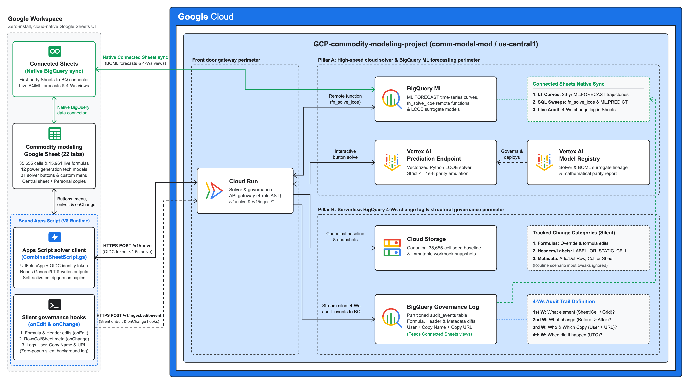
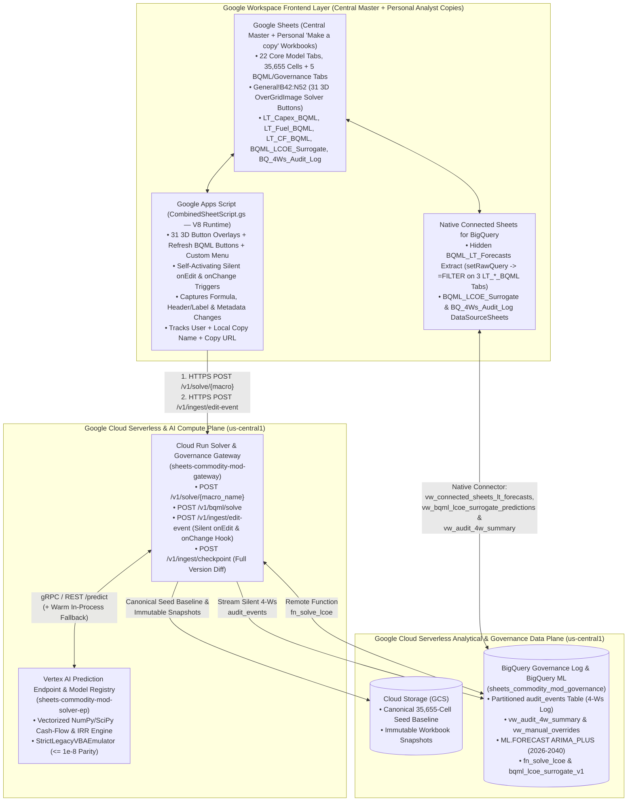
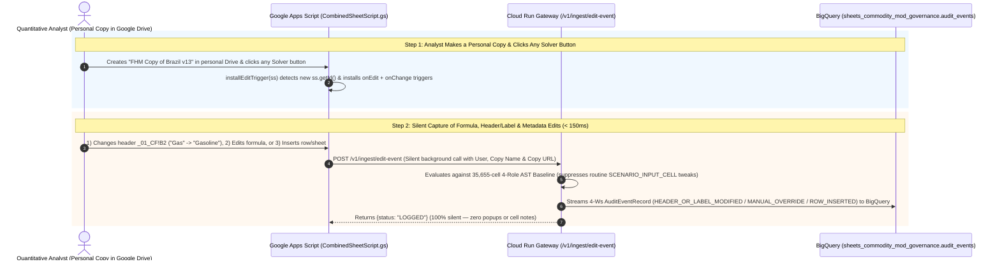
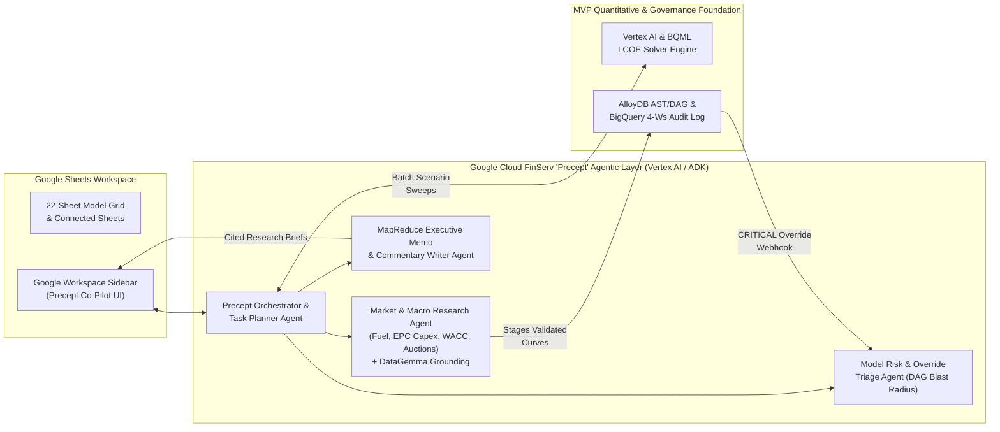

# System Design Document: Enterprise Commodity Modeling — Google Sheets Modernization & Structural Governance Platform

| Document Metadata | Details |
| :--- | :--- |
| **Document ID** | `ENT-SDD-SHEETS-MOD-002` |
| **Related PRD** | `docs/01_PRD_Google_Sheets.md` (`ENT-PRD-SHEETS-MOD-001`) |
| **Version** | `1.0.0 (Executive, Product & Engineering Reference)` |
| **Date** | October 29, 2026 |
| **Authors** | Principal Google Cloud Architect & Staff Quantitative Systems Engineer |
| **Target GCP Project & Region** | Parameterized via `var.project_id` / `GCP_PROJECT_ID` (Default Project: `comm-model-mod`, Region: `us-central1`, Zone: `us-central1-a`, BigQuery Location: `us-central1`) |
| **Universal GCP Resource Label** | `app = "sheets-commodity-mod"`, `project = "enterprise-commodity-modernization"`, `env = "mvp"`, `managed-by = "terraform"` |

---

## 1. Plain-English Glossary of Terms

| Term / Acronym | Plain-English Meaning | Why It Matters in This Project |
| :--- | :--- | :--- |
| **LCOE (Levelized Cost of Electricity)** | The breakeven price of electricity (in currency per Megawatt-hour, e.g., `R$/MWh` or `$/MWh`) a power plant must charge over its 25-to-40-year operating life to cover construction costs (Capex), fuel, operations, taxes, and debt while earning a target return (e.g., **12% IRR**). | LCOE is the primary output metric of the entire 22-sheet model (`Output_1`, `Output_2`, `Output_3`). |
| **IRR (Internal Rate of Return)** | The annualized percentage return earned by a power plant's cash flows over its lifetime (`B18` on each `_XX_CF` sheet). | Every sensitivity button in the model works backward: it searches for the electricity price (`B16`) that makes the project's IRR equal **12.00%** (or **8.0001%** for Distributed Generation Tornado runs). |
| **Tornado Sensitivity (`calcule_tir1..12`)** | A sensitivity analysis that tests one input variable at a time (e.g., Capex, Fuel Cost, Interest Rate, Economic Life) at Low, Base, and High values ($7 \times 3 = 21$ runs) to rank which assumption has the largest impact on plant economics. | Powers the Tornado charts on `Output_2` and the `E6:G12` tables on `_01_CF` through `_12_CF`. |
| **CVU (Variable Unit Cost / *Custo Variável Unitário*)** | The marginal cost (per MWh) of burning fuel (Natural Gas, LNG, Coal, or Biomass) to generate electricity when a thermal plant is dispatched. | Drives the 1D fuel sweep buttons (`calculo_cvu1..12`) and thermal dispatch rules. |
| **GF (*Garantia Física*) & ICB (*Índice Custo-Benefício*)** | **Physical Guarantee (`GF`)** is the firm energy a thermal power plant is certified to deliver, calculated via a quadratic curve on `CVU_GF`. **Cost-Benefit Index (`ICB`)** adjusts a thermal plant's breakeven revenue by its dispatch probability (`fator k` and `GF`). | For thermal plants (`_01_CF`, `_07_CF`, `_08_CF`, `_09_CF`), the 23-year forecast (`lcoe_exec`) writes **`ICB`** (`I81` or `I105`)—not raw `B16`—into `Output_3`. |
| **Google Apps Script (`V8` Runtime)** | Google Workspace's native cloud JavaScript runtime bound directly to the Google Sheet. | Powers the **31 interactive 3D solver buttons** on `General!B42:N52`, the `Refresh BQML` buttons on `LT_Capex_BQML` / `LT_Fuel_BQML` / `LT_CF_BQML`, the `"Commodity Modeling"` menu, and the silent `onEdit`/`onChange` audit hooks. |
| **Connected Sheets for BigQuery** | Google Sheets' native, first-party live data connector to Google BigQuery (`DataSourceTable` Extracts and `DataSourceSheet` tabs). | Powers the three workbook-styled BQML forecast sheets (`LT_Capex_BQML`, `LT_Fuel_BQML`, `LT_CF_BQML` backed by hidden Extract `BQML_LT_Forecasts`), `BQML_LCOE_Surrogate`, and `BQ_4Ws_Audit_Log` with one-click refresh. |
| **AST (Abstract Syntax Tree)** | A structured representation of every cell's formula, data type, coordinate, and semantic role across all 22 worksheets (`35,655` cells). | Enables our governance backend to inspect spreadsheet structure mathematically without manual human review. |
| **DAG (Directed Acyclic Graph)** | The network map of cell-to-cell formula dependencies (which **precedent** cell feeds which **dependent** cell across all 22 sheets). | Allows instant lineage and blast-radius queries (e.g., *"If `_01_CF!G23` is overridden, which cells on `Output_1` and `Output_3` are impacted?"*). |
| **R1C1 Relative Formula Notation** | A way of writing spreadsheet formulas based on relative distance from the current cell (e.g., *"multiply the cell 2 rows up by the cell 1 column left"*, `R[-2]C*RC[-1]`) instead of fixed letters/numbers (`=C21*B23`). | When an analyst inserts a new row, hundreds of formulas shift down (`C23` becomes `C24`), even though their logic did not change. Comparing R1C1 notation prevents hundreds of false-positive audit alerts. |
| **The "4 Ws" of Model Governance** | **1st W:** *What Element* (`_01_CF!G23`), **2nd W:** *What Change* (`MANUAL_OVERRIDE`: formula replaced by `1,250,000,000`), **3rd W:** *Who & Which Copy* (Google Workspace email + OIDC principal + **local spreadsheet copy name** + **clickable Google Drive URL & `spreadsheet_id`**), **4th W:** *When* (UTC timestamp). | The regulatory and model-risk standard enforced across both the central master Google Sheet and every personal analyst copy created via `File -> Make a copy`. |

---

## 2. Executive Summary: Why Google Sheets + Google Cloud?

Transitioning the frontend from single-user desktop spreadsheet files to **Google Sheets** natively integrated with **Google Cloud (Cloud Run, Vertex AI, BigQuery ML, BigQuery Governance Log, and GCS)** unlocks three transformative advantages while keeping the familiar 22-sheet spreadsheet grid and supporting the real-world analyst workflow of creating personal scenario copies (`File -> Make a copy`) in Google Drive:

| Dimension | Legacy Desktop Spreadsheet Workflow | Modernized Google Sheets + Google Cloud Platform |
| :--- | :--- | :--- |
| **User Interface & Distributed Copy Workflow** | Isolated `.xlsm` files emailed between laptops (`v12_final_RJEB.xlsm`); zero centralized visibility into personal scenario copies. | Cloud-native **Google Sheets** where analysts can either collaborate on the central master sheet or make personal scenario copies (`File -> Make a copy`) in their own Google Drive while remaining centrally governed with native identity (`Session.getActiveUser().getEmail()`) and copy-location tracking. |
| **Quantitative Solver Speed (Pillar A)** | Single-threaded local `GoalSeek` + `0.001` stepping freezes the UI for **5 to 20+ minutes** during `lcoe_exec` (184 solves). | Clicking any of the **31 3D cell buttons** on `General!B42:N52` (in the central sheet or any personal copy) invokes our vectorized **Vertex AI / Cloud Run Solver** via Apps Script, completing in **$< 0.8\text{s}$** (single sheet) to **$< 2.0\text{s}$** (`lcoe_exec`) with **$\le 10^{-8}$ numerical parity**. |
| **Data & ML Integration (Pillar A)** | Long-term input curves (`LT Capex`, `LT Fuel`, `LT CF`) are copy-pasted manually from external spreadsheets. | **Native Connected Sheets for BigQuery** powers three dedicated, workbook-styled BQML tabs (**`LT_Capex_BQML`**, **`LT_Fuel_BQML`**, **`LT_CF_BQML`**) displaying `<=2025` actuals + `2026–2040` **`ARIMA_PLUS`** forecasts with 1-click **`Refresh BQML`** buttons, alongside **`BQML_LCOE_Surrogate`** (`ML.PREDICT` over `bqml_lcoe_surrogate_v1`). |
| **Structural Governance & Auditability (Pillar B)** | Undocumented manual overrides (typing a hardcoded number over a live formula) go undetected; `Version Control` tab is updated manually by hand. | **Zero-Touch Silent Distributed Copy Governance:** Self-activating `onEdit` and `onChange` triggers silently capture Formula edits (`MANUAL_OVERRIDE`, `FORMULA_MODIFIED`), Table Header/Label edits (`HEADER_OR_LABEL_MODIFIED`), and Spreadsheet Metadata changes (`ROW_INSERTED`/`DELETED`, `COL_INSERTED`/`DELETED`, `SHEET_ADDED`/`DELETED`) in **BigQuery** (`audit_events` & Connected Sheet `BQ_4Ws_Audit_Log`). |

---

## 3. High-Level System Architecture



*Vector source: [`docs/GCP_System_Architecture_Diagram_Google_Sheets.svg`](./GCP_System_Architecture_Diagram_Google_Sheets.svg) | High-resolution PNG: [`docs/GCP_System_Architecture_Diagram_Google_Sheets.png`](./GCP_System_Architecture_Diagram_Google_Sheets.png)*



---

## 4. Deep Dive: Pillar A — Cloud Solver, Vertex AI & Native Connected Sheets for BigQuery

### 4.1 How the Two-Stage Quantitative Solver Achieves Sub-Second Speed with $\le 10^{-8}$ Parity

In the original model, solving for the breakeven electricity price (`B16`) uses a two-stage loop:
1. **Stage 1 (`iter_conv`):** Runs spreadsheet `GoalSeek` to bring the project's IRR (`B18`) to an intermediate target of **`8.0001%`** (or **`12.001%`** for `iter_conv_gd` on `_11_CF`/`_12_CF`, or **`8.00%`** for `iter_conv_forecast`).
2. **Stage 2 (`iter_refining`):** Starting from Stage 1's price $P_0$, adds or subtracts **`0.001`** (`step_incr = 0.001`) in a loop until $|\text{IRR}_{\text{target}} - \text{IRR}(P_k)| \le 10^{-5}$ (where $\text{IRR}_{\text{target}} = 12.00\%$).

**Why Legacy Sequential Stepping Is Slow—and How Our Vectorized Lattice Search Solves It Instantly:**
- Moving from an `8.0001%` IRR price ($P_0 \approx 265.1125$) to a `12.00%` IRR price ($P_{k^*} \approx 321.8405$) in steps of $\Delta P = 0.001$ requires **$56,728$ sequential spreadsheet recalculations** for a single solve ($184 \times 56,728 \approx 10.4\text{ million}$ recalculations during `lcoe_exec`!).
- If we simply replaced Stage 2 with a continuous root-finder (`scipy.optimize.brentq`), it would find the continuous root $P_{\text{exact}}$ where $\text{IRR}(P_{\text{exact}}) = 0.12000000$, whereas the legacy loop stops at the **first discrete step $k^*$** on the $P_0 + s \cdot k \cdot 0.001$ lattice that enters the tolerance band $[0.11999, 0.12001]$ (leaving a residual difference of $\approx 10^{-4}$).
- **Our Solution (`StrictLegacyVBAEmulator` in `src/solver/convergence.py`):**
  1. Replicates Stage 1 (`iter_conv`) to obtain the exact starting lattice anchor $P_0$.
  2. Uses `brentq` in $\approx 8$ evaluations to locate the continuous entry boundary $\text{IRR}(P) = \text{IRR}_{\text{target}} - s \cdot \epsilon$, yielding an approximate integer index $\hat{k} = \lfloor |P_{\text{cont}} - P_0| / \Delta P \rfloor$.
  3. Performs a bracketed integer binary search over $k \in \mathbb{Z}_{\ge 1}$ on the discrete lattice $P_k = P_0 + s \cdot k \cdot \Delta P$ to find the **unique minimum integer $k^*$** satisfying:
     $$\left|\text{IRR}_{\text{target}} - \text{IRR}(P_{k^*-1})\right| > \epsilon \quad \text{and} \quad \left|\text{IRR}_{\text{target}} - \text{IRR}(P_{k^*})\right| \le \epsilon$$
  4. **Result:** Reduces 56,000+ iterations to **$\le 14$ vectorized NumPy evaluations ($< 0.3\text{ ms}$)** while landing on the **exact same floating-point number $P_{k^*}$** to within $\le 10^{-8}$ relative error across all 854 baseline outputs.

### 4.2 Connected Sheets Extract + Live `=FILTER(...)` Pattern for Styled BQML Sheets
Google Sheets distinguishes between two Connected Sheets APIs in Apps Script:
- `ss.insertDataSourceSheet(spec)` creates a locked `DATA_SOURCE` sheet (ideal for standalone tabular views like `BQML_LCOE_Surrogate` and `BQ_4Ws_Audit_Log`, using `.setTableId(...)`), which prevents standard `=Sheet!A1` cell formulas on other tabs from reading it directly.
- `ss.insertSheetWithDataSourceTable(spec)` (using `.setRawQuery("SELECT * FROM \`comm-model-mod.sheets_commodity_mod_governance.vw_connected_sheets_lt_forecasts\` ORDER BY curve_sheet, Yr")`) creates a regular grid sheet (`BQML_LT_Forecasts`, hidden from the bottom tab bar) containing a live-refreshable Connected Sheets `DataSourceTable` Extract.
- Three workbook-styled sheets duplicated from `LT Capex`, `LT Fuel`, and `LT CF`—**`LT_Capex_BQML`**, **`LT_Fuel_BQML`**, and **`LT_CF_BQML`**—use live `=FILTER(BQML_LT_Forecasts!...)` formulas to project each curve family into exact native workbook formatting (`#0F243E` navy headers, `#,##0` / `0.00` / `0.0%` number formats, and soft-blue `#E6F4FB` conditional formatting on `2026–2040` `ARIMA_PLUS` forecast rows), with a 3D **`Refresh BQML`** button (`M1`, `M1`, `H1`) bound to `refreshBqmlForecasts()` (`dsTable.forceRefreshData()`).

### 4.3 End-to-End Sequence: Interactive Button Click & Connected Sheets Refresh

```mermaid
sequenceDiagram
    autonumber
    actor Analyst as Quantitative Analyst (Personal Copy or Central Sheet)
    participant Sheet as Google Sheets Grid (Core + BQML Tabs)
    participant GAS as Google Apps Script (CombinedSheetScript.gs)
    participant CR as Cloud Run Gateway (/v1/solve & /v1/ingest)
    participant VAI as Vertex AI Endpoint (/predict)
    participant BQ as BigQuery & BQML (Connected Sheets)

    rect rgb(235, 245, 255)
        Note over Analyst,BQ: Flow A: Native Connected Sheets Refresh (3 Styled BQML Forecast Tabs)
        Analyst->>GAS: Clicks "Refresh BQML" 3D button on LT_Capex_BQML / LT_Fuel_BQML / LT_CF_BQML
        GAS->>BQ: dsTable.forceRefreshData() on hidden BQML_LT_Forecasts Extract (vw_connected_sheets_lt_forecasts)
        BQ-->>Sheet: Streams <=2025 Actuals + 2026-2040 ARIMA_PLUS Forecasts; =FILTER() updates all 3 tabs live
    end

    rect rgb(235, 255, 240)
        Note over Analyst,VAI: Flow B: Interactive Solver Button Click + Self-Activating Copy Governance
        Analyst->>GAS: Clicks 3D button "Forecast LCOE" (General!B43) in personal copy
        GAS->>Sheet: Reads General!C5:N40, LT Capex, LT Fuel, LT CF via SpreadsheetApp
        GAS->>CR: POST /v1/solve/lcoe_exec (Bearer: ScriptApp.getIdentityToken())
        CR->>VAI: POST /predict (instances: [macro_name, overrides])
        VAI->>VAI: Runs 184 vectorized 2-stage solves + Thermal GF/fator k/icb math
        VAI-->>CR: Returns 184 solved LCOE/ICB values + Output_3!B3 timestamp (< 1.5s)
        CR-->>GAS: Returns SolveMacroResponse (cell_updates[])
        GAS->>Sheet: Writes cell_updates via range.setValues()
        GAS->>GAS: installEditTrigger(ss) self-installs onEdit & onChange triggers on this copy
    end
```

---

## 5. Deep Dive: Pillar B — Distributed Copy Governance & Silent BigQuery Change Tracking

### 5.1 Why Distributed Copy Governance & Self-Activating Triggers Are Essential

In enterprise commodity modeling, analysts do not all edit a single centralized spreadsheet simultaneously. Instead, the standard workflow is:
1. A Lead Quantitative Analyst or Admin maintains the **central governed Google Sheet** (`Regional Power Generation Techno-Economic Model — Brazil v13 (Governed)`).
2. Individual analysts open the central sheet and select **`File -> Make a copy`** to create a **personal scenario copy** (e.g., `FHM Copy of Regional Power Generation Techno-Economic Model`) inside their own Google Drive to modify assumptions and run solver routines.

While `File -> Make a copy` preserves all worksheets, the 31 3D `OverGridImage` buttons on `General!B42:N52`, the Connected Sheets BQML tabs, and the bound Apps Script (`CombinedSheetScript.gs`), **Google Workspace strips Installable Triggers (`ScriptApp.newTrigger`) from newly copied files by design**.

Our **Zero-Touch Silent Distributed Copy Governance Architecture (`DEC-04`)** solves this automatically:

1. **Self-Activating `onEdit` & `onChange` Triggers on First Solver Click (`installEditTrigger`):**
   - Every one of the 31 solver buttons on `General!B42:N52` invokes `invokeCloudSolver(macroName)`.
   - Immediately after writing the solved LCOE/IRR outputs to the sheet, `invokeCloudSolver` calls `installEditTrigger(ss)`: when an analyst runs a solver button in a newly created copy (`File -> Make a copy`), `ss.getId()` is a brand-new `spreadsheetId`, so `installEditTrigger(ss)` automatically registers both `onGovernedSheetEdit` (`.onEdit()`) and `onGovernedSheetChange` (`.onChange()`) on that copy.

2. **Category 1 & 2 — Silent Formula & Table Header/Label Tracking (`onGovernedSheetEdit` $\rightarrow$ `POST /v1/ingest/edit-event`):**
   - Whenever a user edits a cell in the central sheet or any personal copy, `onGovernedSheetEdit(e)` silently sends the edit metadata—including the **user email**, **local spreadsheet copy name (`ss.getName()`)**, and **local copy URL (`ss.getUrl()`)**—to `POST /v1/ingest/edit-event`.
   - **Seed-Baseline Comparison:** The backend compares the edited cell against the cached 35,655-cell canonical baseline (`seed/2023-11-27-Brazil_TT_v13_RJEB.xlsm`).
   - **Routine Input Noise Suppression:** Routine numeric tweaks to `SCENARIO_INPUT_CELL` coordinates (e.g., changing capacity factor in `General!C16`) return `SUPPRESSED` with **zero (`0`) audit noise**.
   - **Formula Override & Formula Edit Capture:** Overwriting a live `FORMULA_CELL` (such as `_01_CF!G23`) with a literal logs a `CRITICAL` **`MANUAL_OVERRIDE`** event to BigQuery `audit_events`, and altering or adding a formula logs `WARNING` **`FORMULA_MODIFIED`** or `INFO` **`FORMULA_ADDED`**.
   - **Table Header & Label Capture (`LABEL_OR_STATIC_CELL`):** Modifying any `LABEL_OR_STATIC_CELL` text cell (for example, changing the heading in `_01_CF!B2:H2` from `"Gas"` to `"Gasoline"`) logs a `WARNING` **`HEADER_OR_LABEL_MODIFIED`** event with `before_value="Gas"` and `after_value="Gasoline"`.

3. **Category 3 — Silent Spreadsheet Metadata & Structural Tracking (`onGovernedSheetChange` $\rightarrow$ `POST /v1/ingest/edit-event`):**
   - Whenever a user inserts or deletes a row (`INSERT_ROW`, `REMOVE_ROW`), inserts or deletes a column (`INSERT_COLUMN`, `REMOVE_COLUMN`), or adds/deletes a worksheet (`INSERT_GRID`, `REMOVE_GRID`), `onGovernedSheetChange(e)` silently streams a `ROW_INSERTED`, `ROW_DELETED`, `COL_INSERTED`, `COL_DELETED`, `SHEET_ADDED`, or `SHEET_DELETED` event to BigQuery (`sheets_commodity_mod_governance.audit_events`) with the user email, local copy name, active sheet name, and copy URL.

### 5.2 Point-in-Time Version Recovery & Single-Cell Rollback
Note that `gcs_snapshot_uri` (surfaced as `copy_location_url` in `vw_audit_4w_summary` and `BQ_4Ws_Audit_Log`) stores the live Google Drive URL (`https://docs.google.com/spreadsheets/d/<id>/edit`) of the specific central or copied spreadsheet rather than a static frozen file snapshot. When an unwanted edit occurs, model owners have two complementary recovery paths:
1. **Surgical Single-Cell Rollback (Directly from BigQuery / `BQ_4Ws_Audit_Log`):** Every `MANUAL_OVERRIDE` and `FORMULA_MODIFIED` event preserves the exact `before_formula` and `before_value` alongside `sheet_name` and `cell_coord`, allowing an owner to paste the original formula straight back into that cell without disturbing other work.
2. **Full-Workbook Point-in-Time Restore (Google Sheets Version History + `when_event_utc`):** Clicking `copy_location_url` opens the exact workbook where a structural edit (`ROW_INSERTED`, `COL_DELETED`, etc.) happened; opening **File > Version history > See version history** (`Cmd + Option + Shift + H`) and matching the `when_event_utc` timestamp from BigQuery lets an owner restore (or make a clean copy of) the workbook right before that change.



---

## 6. Dual-Mode Engineering (`ENV=local` vs. `ENV=gcp`) & Shared-Project Guardrails

To allow rapid development and deterministic CI testing on any laptop (before or after deploying to Google Cloud), the entire codebase supports **Dual-Mode Execution** controlled by a single environment variable (`ENV=local` vs. `ENV=gcp`):

| Subsystem | `ENV=local` (Local Developer & CI Mode) | `ENV=gcp` (Google Cloud Production Mode in `us-central1`) |
| :--- | :--- | :--- |
| **Frontend / Client Trigger** | CLI simulators (`sheets-mod-solve`, `sheets-mod-ingest`) + PyTest `AsyncClient` | Live **Google Sheets** + **Apps Script (`CombinedSheetScript.gs`)** + **Connected Sheets for BigQuery** |
| **Authentication (`src/core/security.py`)** | Accepts `X-Local-Principal` / local Bearer token (`LOCAL_DEV_AUTH_BYPASS=true`) | Verifies Google OIDC token from `ScriptApp.getIdentityToken()` and Apps Script background trigger principal |
| **Solver Compute** | Local in-process `WorkbookSolverContext` | **Cloud Run Gateway** (`sheets-commodity-mod-gateway`) $\rightarrow$ **Vertex AI Prediction Endpoint** |
| **Immutable Snapshot Storage** | `LocalFilesystemSnapshotStore` (`./data/snapshots/`) | `GCSSnapshotStore` (`gs://<project_id>-sheets-mod-snapshots/`) |
| **Governance Change Log & ML Warehouse** | Local SQLite + JSONL sink (`./data/bigquery_sink/audit_events.jsonl`) | **BigQuery & BigQuery ML** (`comm-model-mod.sheets_commodity_mod_governance.audit_events` & `vw_audit_4w_summary` in `us-central1`) |

### Shared-Project Blast-Radius Isolation (`INFRA-06`)
When deployed into a shared Google Cloud project (`var.project_id`):
1. **No `google_project` resource management** (project is referenced read-only via `var.project_id`).
2. **`disable_on_destroy = false`** on all `google_project_service` resources so `terraform destroy` never disables APIs used by other workloads.
3. **Additive-only IAM (`google_project_iam_member`)** scoped to our `sheets-mod-*-sa` service accounts (zero `google_project_iam_policy` or `google_project_iam_binding`).
4. **Universal labels** (`app = "sheets-commodity-mod"`).

---

## 7. Version 2 Architecture: Google Cloud FinServ "Precept" Agentic Framework

In Version 2, the platform extends effortlessly into an agentic financial research workspace powered by the **Google Cloud Financial Services "Precept" Agentic Framework** (built on Google ADK and Gemini):



