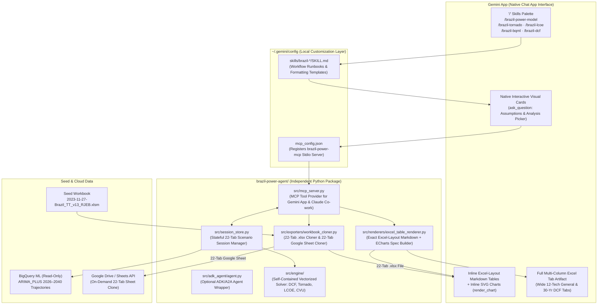

# Brazil Energy Model (v13) — Native Gemini App Skills & MCP Prototype Design

**Date:** 2026-11-08
**Status:** Draft for Review
**Scope:** Independent prototype (`brazil-power-agent/`) encapsulating the Brazil Power Generation Techno-Economic Model (`2023-11-27-Brazil_TT_v13_RJEB.xlsm`) inside the Gemini App via `/skills`, an MCP Server (`brazil-power-mcp`), native interactive cards, Excel-layout in-app table/chart rendering, and full 22-tab `.xlsx` / Google Sheets export.

---

## 1. Objectives & Core Principles

1. **No Custom Web UI Replacement**: Do not replace Excel/Google Sheets with another bespoke web app. The analyst interacts directly inside the **Gemini App (`Chat App`)** using `/` skills, `@` mentions, natural language prompts, and native visual cards.
2. **Complete Independence from v1 Telemetry & Governance Dashboards**: The prototype lives in its own isolated directory (`brazil-power-agent/`) and does not write to or depend on the existing `/telemetry` or `/governance` web dashboards.
3. **Interactive Visual Cards for Assumptions & Analysis Selection**:
   - Analysts can enter or modify scenario assumptions (Fuel Price, Specific CAPEX, Real WACC, Construction Lead Time, Capacity Factor, Fixed/Variable O&M, Tariff) either via natural language or through Gemini App's native interactive selection/input cards (`ask_question`).
   - Analysts select and trigger quantitative workflows (**Tornado IRR Sensitivity**, **Time-Series Forecast Refresh via BigQuery ML `ARIMA_PLUS`**, **23-Year Multi-Tech LCOE Forecast**, **30-Year DCF Cash Flow Analysis**, and **Thermal CVU / Physical Guarantee Sweeps**) via visual cards or direct `/` shortcut skills.
4. **In-App Rendering Matching Original Excel Layout**:
   - Key output tables and Apache ECharts visuals (`render_chart`) are rendered **directly inline in the chat stream**, formatted to mirror the row/column structure, cell coordinates, units, and headers of the original Excel tabs (`General`, `Output_1`, `Output_2`, `Output_3`, `_01_CF.._12_CF`, `LT Capex`, `LT Fuel`, `LT CF`, `CVU_GF`).
   - Wide multi-column tables (such as the 12-technology `General!C5:N40` parameter grid or the 30-year `_01_CF.._12_CF` DCF schedule) are **also** written as a full multi-column Excel-Tab Replica Artifact in the side panel for side-by-side inspection.
5. **100% Faithful 22-Tab Excel (`.xlsx`) & Google Sheet Deliverable Export**:
   - When the analyst exports to Excel or Google Sheets, the exporter produces the **complete 22-tab workbook** matching the exact layout, formatting, colors, borders, number formats, and formulas of [`2023-11-27-Brazil_TT_v13_RJEB.xlsm`](../../brazil-power-v13/seed/2023-11-27-Brazil_TT_v13_RJEB.xlsm) and the Golden Google Sheet (`1apbos5xVpK4yBLiRFxQqAEyPVNkkYQ2ZvgAASibYYJI`), with all session assumption changes and solved macro outputs populated across all 22 tabs.

---

## 2. System Architecture

---

## 3. Component Specification

### 3.1 Gemini App Skills (`~/.gemini/config/skills/` & `brazil-power-agent/skills/`)

We provide a primary guided workflow skill plus four direct analysis shortcut skills:

| Skill Command | Skill Directory | Purpose & Workflow |
| :--- | :--- | :--- |
| **`/brazil-power-model`** | `brazil-power-model/` | **Primary End-to-End Guided Workflow**: 1) Displays or collects scenario assumption changes via an interactive card (`ask_question`) or natural language; 2) Updates the session state and renders the updated `General` Excel table diff; 3) Presents an interactive Analysis Picker card (`Tornado`, `BQML Forecast`, `23-Yr LCOE`, `DCF Cash Flow`, `CVU Sweep`); 4) Renders the Excel-replica output table + chart inline (and wide tab in an Artifact); 5) Offers 1-click 22-tab `.xlsx` or Google Sheets export. |
| **`/brazil-tornado`** | `brazil-tornado/` | **Direct Tornado IRR Sensitivity Shortcut**: Prompts for technology (`_01_CF` .. `_12_CF` or `All 12`) and any quick input tweaks via an interactive card, executes `calcule_tir<N>` (21 binary-search IRR solves across 7 parameters: WACC, Capex, CF, O&M, Lead Time, Tariff, Fuel), renders the exact `_0N_CF!E6:G12` & `Output_1` table + horizontal Tornado EChart inline. |
| **`/brazil-lcoe`** | `brazil-lcoe/` | **Direct 23-Year LCOE Forecast Shortcut**: Runs `lcoe_exec` (184 binary-search LCOE solves across `2024–2046` + Thermal ICB dispatch), renders the exact `Output_3!B9:J31` (`2024–2046` × technologies in `R$/MWh`) table inline + full table Artifact + multi-technology trajectory chart. |
| **`/brazil-bqml`** | `brazil-bqml/` | **Direct BigQuery ML Time-Series Forecast Shortcut**: Queries/refreshes the 15-year `ARIMA_PLUS` (`2026–2040`) trajectories from `comm-model-mod.sheets_commodity_mod_governance.vw_connected_sheets_lt_forecasts`, injects them into the session's `LT Capex`, `LT Fuel`, and `LT CF` tabs, and renders the Excel-layout trajectory matrices + confidence interval chart inline. |
| **`/brazil-dcf`** | `brazil-dcf/` | **Direct Project DCF & Cash Flow Shortcut**: Computes the 30-year (`2024–2053`) Project & Equity Cash Flow statement for any technology tab (`_01_CF` .. `_12_CF`), renders the headline valuation block (`Project IRR`, `Equity IRR`, `NPV @ WACC`, `LCOE`, `Payback`) + key operational years inline in chat, and writes the complete 30-column Excel-layout `_0N_CF` tab into a side-pane Artifact. |

---

### 3.2 MCP Server (`brazil-power-mcp`) Tool Surface

Registered in `~/.gemini/config/mcp_config.json` (using Stdio transport so it works automatically in both the Gemini App and Claude Co-work), exposing 7 deterministic tools:

1. **`get_session_assumptions`**:
   - **Arguments**: `technologies: list[str] | None`, `include_full_general_tab: bool = True`
   - **Behavior**: Returns the current session's `General!C5:N40` assumptions table (both baseline values from [`2023-11-27-Brazil_TT_v13_RJEB.xlsm`](../../brazil-power-v13/seed/2023-11-27-Brazil_TT_v13_RJEB.xlsm) and any staged overrides with `Baseline → Current (Δ%)`), formatted as an Excel-coordinate Markdown table (`Row #`, `Parameter Name`, `Unit`, `Col C (_01_CF Gas CCGT)` .. `Col N (_12_CF)`).
2. **`update_session_assumptions`**:
   - **Arguments**: `overrides: dict[str, dict[str, float]]` (e.g. `{"_01_CF": {"fuel_cost_r_per_mmbtu": 6.50, "real_wacc": 0.09}, "_06_CF": {"lead_time_years": 2}}` or raw cell coordinates `{"General!C20": 6.50, "General!H14": 2}`), `reset_to_baseline: bool = False`
   - **Behavior**: Stages the parameter changes in the persistent session store (`~/.gemini/jetski/brazil_power_agent_session.json`), recalculates dependent `General` rows, and returns the formatted Excel diff table showing modified cell coordinates (`General!C20`, `General!H14`, etc.).
3. **`run_tornado_sensitivity`**:
   - **Arguments**: `technology_code: str` (`"_01_CF"` .. `"_12_CF"` or `"ALL"`)
   - **Behavior**: Runs the 21-point 2-Stage Discrete Lattice Binary Search IRR sensitivity (`calcule_tir1..12`), updates `_0N_CF!E6:G12` and `Output_1` in the session state, and returns:
     - `inline_excel_table_md`: Exact replica of `_0N_CF!D5:G12` (`Parameter | -10% | Base | +10% | Spread (bps)`) and `Output_1` summary.
     - `echarts_spec`: Ready-to-render Apache ECharts V5 horizontal Tornado bar specification for `render_chart`.
4. **`run_bqml_timeseries_refresh`**:
   - **Arguments**: `curve_types: list[str] = ["CAPEX", "FUEL", "CF"]`, `apply_to_session_lt_tabs: bool = True`
   - **Behavior**: Queries `comm-model-mod.sheets_commodity_mod_governance.vw_connected_sheets_lt_forecasts` (with automatic offline local `ARIMA_PLUS` snapshot fallback), updates `LT Capex`, `LT Fuel`, and `LT CF` in the session workbook state, and returns the exact Excel-layout trajectory table (`2024–2046` across the 12 technology columns) + ECharts fan chart spec.
5. **`run_lcoe_horizon_forecast`**:
   - **Arguments**: `parity_mode: str = "strict_legacy_vba"`
   - **Behavior**: Executes `lcoe_exec` (184 binary-search LCOE solves from `2024` to `2046` plus Thermal ICB dispatch), updates `Output_3!B9:J31` and `Output_3!B3` in the session workbook state, and returns both a compact inline Markdown table, the full 23-row × 9-column `Output_3` Excel-layout Markdown table, and a multi-series LCOE trajectory ECharts spec.
6. **`run_dcf_cashflow_analysis`**:
   - **Arguments**: `technology_code: str` (`"_01_CF"` .. `"_12_CF"`), `start_year: int = 2024`, `end_year: int = 2053`
   - **Behavior**: Executes the vectorized 30-year DCF cash flow engine for the target technology, updates the corresponding `_0N_CF` and `Output_2` cells in the session state, and returns:
     - `inline_summary_table_md`: Executive Excel header block (`_0N_CF!B2:G14`: Installed Capacity, Capex, Lead Time, CF, WACC, Tariff/LCOE, Project IRR, Equity IRR, NPV) + key milestone years (`2024–2030`, `2035`, `2040`, `2045`, `2050`, `2053`).
     - `full_artifact_table_md`: Complete 30-year (`2024–2053`) horizontal Excel replica of `_0N_CF` (Rows 15–48: CAPEX Drawdown, Physical Generation, Gross Revenue, Fuel Cost, Fixed O&M, Sector Charges, EBITDA, Depreciation, EBIT, Income Tax, Free Cash Flow to Firm, Cumulative Discounted FCF) to write into a side-pane Artifact.
     - `echarts_spec`: Free Cash Flow & Cumulative Discounted NPV waterfall/bar-line chart spec.
7. **`export_full_22tab_workbook`**:
   - **Arguments**: `export_format: str = "xlsx"` (`"xlsx"`, `"google_sheets"`, or `"both"`), `output_filename: str | None = None`, `sheet_title: str | None = None`
   - **Behavior**:
     - **For `"xlsx"`**: Loads a clean copy of the 22-tab [`2023-11-27-Brazil_TT_v13_RJEB.xlsm`](../../brazil-power-v13/seed/2023-11-27-Brazil_TT_v13_RJEB.xlsm) in `openpyxl` (preserving all 22 worksheets: `Version Control`, `General`, `Output_1`, `Output_2`, `Output_3`, `_01_CF` .. `_12_CF`, `_CAPEX 01`, `CVU_GF`, `LT Capex`, `LT Fuel`, `LT CF`, along with all original styles, fonts, fills, borders, number formats, column widths, merged cells, and Excel formulas), writes all session input overrides and all solved output arrays (`_01_CF.._12_CF!E6:G12`, `Output_3!B9:J31`, `Output_3!B3`, `CVU_GF`, `LT Capex`, `LT Fuel`, `LT CF`) into their exact cell coordinates, saves as a standard `.xlsx` file in `brazil-power-agent/exports/`, and returns the clickable `file://` link.
     - **For `"google_sheets"`**: Copies the 22-tab Golden Google Sheet (`1apbos5xVpK4yBLiRFxQqAEyPVNkkYQ2ZvgAASibYYJI`) in Google Drive via the Drive API (`files.copy`) and applies all session input overrides and solved output ranges via `spreadsheets.values.batchUpdate` (`USER_ENTERED`), returning the live `https://docs.google.com/spreadsheets/d/...` URL.

---

## 4. End-to-End Analyst User Journey in Gemini App

1. **Launch**:
   - The analyst opens the Gemini App (`Chat App`) and either types `/brazil-power-model` (or `/brazil-tornado`, `/brazil-lcoe`, `/brazil-bqml`, `/brazil-dcf`) or enters a natural-language prompt such as:
     > *"Let's run a Brazil power session—bump Gas CCGT fuel cost to 6.50 R$/MMBtu and Small Hydro lead time to 2 years."*
2. **Interactive Visual Card for Inputs (When Needed)**:
   - If the analyst starts a session without specifying all parameters, the agent calls `ask_question` to display a native visual card showing the technologies and their current `General` tab baseline values, allowing multi-select and custom value entry.
3. **Live In-App `General` Tab Preview**:
   - The agent calls `update_session_assumptions` and renders the exact `General!B5:N40` slice for the affected technologies inline (and full 12-technology `General` table in an Artifact if requested), highlighting `General!C20: 4.50 → 6.50 (+44.4%)` and `General!H14: 3 → 2 (-33.3%)`.
4. **Interactive Visual Card for Analysis Selection**:
   - The agent displays the native **Analysis Selector Card** (`ask_question`) where the analyst checks one or more analyses to run:
     - `Tornado IRR Sensitivity (Output_1 / _01_CF.._12_CF)`
     - `23-Year Multi-Tech LCOE Forecast (Output_3)`
     - `Time-Series Forecast Refresh — BQML ARIMA_PLUS (LT Capex / Fuel / CF)`
     - `30-Year Project DCF & Cash Flow Schedule (_01_CF.._12_CF / Output_2)`
     - `Thermal CVU / Physical Guarantee Sweep (CVU_GF)`
5. **In-App Excel-Replica Table + Visual Chart + Side-Pane Artifact**:
   - The agent executes the corresponding MCP tool(s), renders the **Excel-layout table** and **ECharts visual** (`render_chart`) inline in the conversation, and writes full wide tables (like the 30-year DCF schedule or full 12-technology `General` grid) to a clickable Markdown Artifact so the analyst never has to open Excel during modeling.
6. **Optional 22-Tab Workbook Export**:
   - At the end of the analysis turn (or whenever asked), the analyst can export the session to a **complete 22-tab `.xlsx` file** or **complete 22-tab Google Sheet** that is structurally identical to the original `Brazil_TT_v13_RJEB` workbook.

---

## 5. Testing & Verification Strategy

1. **Unit & Integration Tests (`brazil-power-agent/tests/`)**:
   - Verify session assumption staging, reset-to-baseline, and cell coordinate mapping against `General!C5:N40`.
   - Verify all 5 analysis tools (`run_tornado_sensitivity`, `run_bqml_timeseries_refresh`, `run_lcoe_horizon_forecast`, `run_dcf_cashflow_analysis`, and CVU sweep) produce deterministic Excel-layout Markdown tables and valid Apache ECharts V5 specs.
   - Verify `export_full_22tab_workbook(export_format="xlsx")` produces a valid `.xlsx` workbook containing all **22 original worksheet tabs** in their exact order, with formulas and styling preserved and modified session inputs/outputs written to the exact cells.
2. **Live MCP & Skills Registration Verification**:
   - Register `brazil-power-mcp` in `~/.gemini/config/mcp_config.json` and install the 5 skills in `~/.gemini/config/skills/`, then execute an end-to-end tool & chart verification run.
