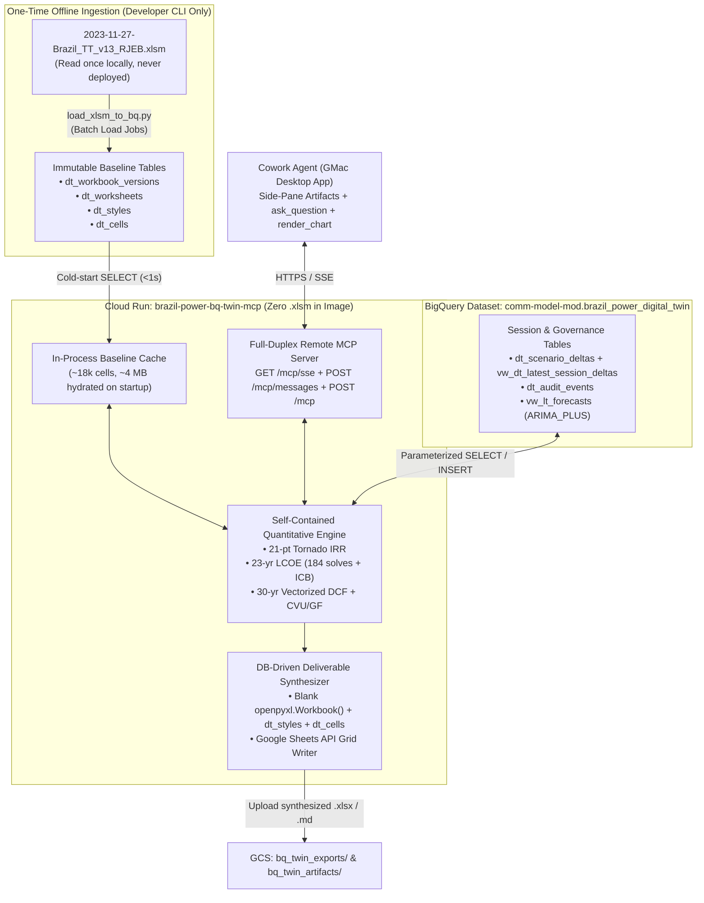

# Brazil Energy Model (v13) — Isolated BigQuery Digital Twin Design Specification

- **Date**: 2026-11-09
- **Status**: Draft for User Review
- **GCP Project**: `comm-model-mod` (`1024543888590`), Region `us-central1`
- **Target Frontend**: Cowork Agent (`Gemini Enterprise` Desktop App on macOS) via Remote SSE MCP (`serverUrl`)

---

## 1. Purpose & Strict Isolation Mandate

### 1.1 Objective
Eliminate all runtime dependency on Excel workbook files (`.xlsm` / `.xlsx`) during quantitative energy modeling, scenario overrides, time-series forecasting, and deliverable generation by representing the entire 22-tab Brazil Power v13 workbook—values, formulas, layout metadata, styles, and scenario deltas—as a **Cloud Digital Twin in Google BigQuery**.

### 1.2 Strict Isolation Guarantees (Zero Coexistence Coupling)
To ensure zero regression risk or coupling with the existing `brazil-power-v13` (Google Sheets gateway) and `brazil-power-mcp` deployments, the new system enforces hard isolation across all four boundaries:

| Boundary | Existing Production Assets (Untouched) | Isolated BigQuery Digital Twin Assets |
|---|---|---|
| **Codebase & Container** | `brazil-power-v13/` & `brazil-power-agent/` | Standalone top-level `brazil-power-bq-twin/` directory with zero runtime imports from `brazil-power-v13` or `brazil-power-agent` and **zero `.xlsm`/`.xlsx` files** in its source tree or Docker image. |
| **BigQuery Dataset** | `comm-model-mod.sheets_commodity_mod_governance` | Dedicated dataset `comm-model-mod.brazil_power_digital_twin` (`us-central1`). |
| **Cloud Storage Prefixes** | `agent_sessions/`, `agent_exports/`, `agent_artifacts/` | Dedicated `bq_twin_exports/` and `bq_twin_artifacts/` prefixes in `gs://comm-model-mod-sheets-mod-artifacts` (used strictly for downloadable deliverables, never for session state). |
| **Cloud Run & Agent Registry** | Cloud Run `sheets-commodity-mod-gateway`; Registry `brazil-power-mcp` & `private-brazil-*` | Dedicated Cloud Run service `brazil-power-bq-twin-mcp`; distinct Agent Registry MCP Server `brazil-power-bq-twin-mcp` and distinct `bq-twin-*` Skills. |

---

## 2. System Architecture & End-to-End Data Flow



### Runtime Lifecycle
1. **One-Time Ingestion (`load_xlsm_to_bq.py`)**: Decompiles the 22-tab `.xlsm` file locally once—extracting worksheet dimensions, merged cell ranges, column widths, row heights, deduplicated style definitions, cell values, raw formulas, semantic roles, and structured solver baseline vectors—and batch-loads them into `comm-model-mod.brazil_power_digital_twin`.
2. **Cold-Start Hydration**: When `brazil-power-bq-twin-mcp` starts on Cloud Run, `BigQueryDigitalTwinStore` executes parameterized queries against `dt_workbook_versions`, `dt_worksheets`, `dt_styles`, and `dt_cells` (`~18,000` rows, `~4 MB`) and caches the immutable `v13_baseline` snapshot in memory.
3. **Session Overlay & Execution**: On every MCP tool call (`session_id` derived from the MCP SSE session or explicit argument), the store queries `vw_dt_latest_session_deltas` for `session_id`, overlays those sparse cell deltas onto an isolated copy of the baseline snapshot (`COALESCE(delta, baseline)`), runs the requested solver or BigQuery ML `ARIMA_PLUS` refresh, and appends the modified input or solved output cells to `dt_scenario_deltas` plus a 4-Ws governance record to `dt_audit_events`.
4. **Pure Database `.xlsx` / Google Sheets Synthesis**: When `export_full_22tab_workbook` is called, `xlsx_synthesizer.py` instantiates an empty `openpyxl.Workbook()`, builds all 22 tabs in `sheet_index` order from `dt_worksheets`, reconstructs `Font`, `PatternFill`, `Border`, `Alignment`, and `number_format` objects from `dt_styles`, applies `merged_ranges` and `col_widths`, and populates every cell using:
   - `session_delta.value` if the cell was overridden or solved in the active session, else
   - `base_cell.raw_formula` (prefixed with `=`) if the baseline cell contains an Excel formula (preserving live spreadsheet recalculation when opened in Excel), else
   - `base_cell.value` (numeric or string literal).

---

## 3. BigQuery Schema Specification (`comm-model-mod.brazil_power_digital_twin`)

All tables reside in `us-central1` and use BigQuery partitioning and clustering to minimize bytes scanned.

### 3.1 `dt_workbook_versions`
Clustered by: `workbook_id, version_id`
- `workbook_id` (`STRING NOT NULL`) — e.g., `"brazil_power_v13"`
- `version_id` (`STRING NOT NULL`) — e.g., `"v13_baseline"`
- `version_label` (`STRING NOT NULL`)
- `total_sheets` (`INT64 NOT NULL`) — `22`
- `total_cells` (`INT64 NOT NULL`)
- `named_ranges_json` (`STRING NOT NULL`) — JSON array of workbook/sheet-scoped named ranges
- `solver_parameters_json` (`STRING NOT NULL`) — Pre-extracted per-sheet baseline vectors (`_01_CF.._12_CF` Tornado bounds, capex schedules, depreciation, tax/financing parameters) derived from `dt_cells` at ingestion time
- `created_at` (`TIMESTAMP NOT NULL`)

### 3.2 `dt_worksheets`
Clustered by: `workbook_id, version_id, sheet_index`
- `workbook_id` (`STRING NOT NULL`)
- `version_id` (`STRING NOT NULL`)
- `sheet_index` (`INT64 NOT NULL`) — `0..21`
- `sheet_name` (`STRING NOT NULL`) — `Version Control`, `General`, `Output_1..3`, `_01_CF.._12_CF`, `_CAPEX 01`, `CVU_GF`, `LT Capex`, `LT Fuel`, `LT CF`
- `visibility` (`STRING NOT NULL`) — `"visible"` | `"hidden"`
- `tab_color_rgb` (`STRING`)
- `merged_ranges_json` (`STRING NOT NULL`) — JSON list of A1 merge strings (e.g., `["B2:N2", ...]`)
- `col_widths_json` (`STRING NOT NULL`) — JSON map of column letter to width float
- `row_heights_json` (`STRING NOT NULL`) — JSON map of row number string to height float
- `freeze_panes_coord` (`STRING`)

### 3.3 `dt_styles`
Clustered by: `workbook_id, version_id, style_id`
- `workbook_id` (`STRING NOT NULL`)
- `version_id` (`STRING NOT NULL`)
- `style_id` (`INT64 NOT NULL`)
- `number_format` (`STRING`)
- `font_json` (`STRING NOT NULL`) — `{name, size, bold, italic, color_rgb}`
- `fill_json` (`STRING NOT NULL`) — `{fill_type, start_color_rgb, end_color_rgb}`
- `border_json` (`STRING NOT NULL`) — `{left, right, top, bottom}` border style/color specs
- `alignment_json` (`STRING NOT NULL`) — `{horizontal, vertical, wrap_text}`

### 3.4 `dt_cells`
Clustered by: `workbook_id, version_id, sheet_name, row_num`
- `workbook_id` (`STRING NOT NULL`)
- `version_id` (`STRING NOT NULL`)
- `sheet_name` (`STRING NOT NULL`)
- `cell_coord` (`STRING NOT NULL`) — Uppercase A1 coordinate (e.g., `"C20"`)
- `row_num` (`INT64 NOT NULL`)
- `col_num` (`INT64 NOT NULL`)
- `data_type` (`STRING NOT NULL`) — `"n"` (numeric), `"s"` (string), `"b"` (boolean), `"f"` (formula)
- `numeric_value` (`FLOAT64`) — Cached numeric value (including cached value of formula cells)
- `string_value` (`STRING`) — String literal or cached string result
- `raw_formula` (`STRING`) — Excel formula text without leading `=` (or `NULL` for literal cells)
- `style_id` (`INT64 NOT NULL`) — Foreign key to `dt_styles.style_id`
- `semantic_role` (`STRING NOT NULL`) — `"INPUT"`, `"FORMULA"`, `"LABEL"`, `"OUTPUT"`

### 3.5 `dt_scenario_deltas` & `vw_dt_latest_session_deltas`
Table partitioned by `DATE(updated_at)`, clustered by `session_id, sheet_name`:
- `session_id` (`STRING NOT NULL`)
- `workbook_id` (`STRING NOT NULL`)
- `base_version_id` (`STRING NOT NULL`)
- `sheet_name` (`STRING NOT NULL`)
- `cell_coord` (`STRING NOT NULL`)
- `row_num` (`INT64 NOT NULL`)
- `col_num` (`INT64 NOT NULL`)
- `delta_kind` (`STRING NOT NULL`) — `"USER_OVERRIDE"`, `"SOLVED_OUTPUT"`, `"BQML_REFRESH"`, `"RESET_TOMBSTONE"`
- `numeric_value` (`FLOAT64`)
- `string_value` (`STRING`)
- `source_tool` (`STRING NOT NULL`)
- `updated_at` (`TIMESTAMP NOT NULL`)

View `vw_dt_latest_session_deltas`:
```sql
SELECT *
FROM `comm-model-mod.brazil_power_digital_twin.dt_scenario_deltas`
QUALIFY ROW_NUMBER() OVER (
  PARTITION BY session_id, workbook_id, base_version_id, sheet_name, cell_coord
  ORDER BY updated_at DESC
) = 1
```
*(When `delta_kind = 'RESET_TOMBSTONE'`, the overlay ignores prior overrides and restores the `v13_baseline` cell.)*

### 3.6 `dt_audit_events`, `dt_lt_trajectories`, & `vw_lt_forecasts`
- **`dt_audit_events`** *(Partitioned by `DATE(when_event_utc)`, Clustered by `session_id, sheet_name`)*: Records immutable 4-Ws audit rows (`event_id`, `session_id`, `what_sheet`, `what_coord`, `what_change_type`, `before_value`, `after_value`, `who_principal`, `when_event_utc`, `why_context`).
- **`dt_lt_trajectories` & `vw_lt_forecasts`**: `load_xlsm_to_bq.py` seeds historical/baseline LT series into `brazil_power_digital_twin.dt_lt_trajectories` and trains/queries an isolated `ARIMA_PLUS` model (`brazil_power_digital_twin.bqml_dt_lt_forecast`) exposed via `brazil_power_digital_twin.vw_lt_forecasts`, ensuring zero cross-dataset dependency on `sheets_commodity_mod_governance`.

---

## 4. Component & File Structure (`brazil-power-bq-twin/`)

```text
brazil-power-bq-twin/
├── Dockerfile                         # Python 3.11-slim; copies ONLY requirements.txt & src/ (zero .xlsm)
├── pyproject.toml
├── requirements.txt
├── scripts/
│   ├── load_xlsm_to_bq.py             # One-time offline CLI: .xlsm -> BigQuery batch load + views
│   ├── install_bq_twin_cowork.py      # Optional local mcp_config.json / skill installer (--remote-sse)
│   └── publish_bq_twin_registry.py    # Registers brazil-power-bq-twin-mcp & bq-twin-* skills in Agent Registry
├── skills/
│   ├── bq-twin-power-model/SKILL.md
│   ├── bq-twin-tornado/SKILL.md
│   ├── bq-twin-bqml/SKILL.md
│   ├── bq-twin-lcoe/SKILL.md
│   └── bq-twin-dcf/SKILL.md
├── src/
│   └── brazil_power_bq_twin/
│       ├── __init__.py
│       ├── config.py                  # Pydantic settings (project, dataset, bucket, bytes-billed cap)
│       ├── schema_ddl.py              # Idempotent BigQuery dataset/table/view DDL definitions
│       ├── bq_store.py                # BigQueryDigitalTwinStore + InMemoryDigitalTwinStore (for pytest)
│       ├── solver_engine.py           # Self-contained Tornado IRR, LCOE, DCF & CVU/GF quantitative engine
│       ├── renderer.py                # Markdown Excel-coordinate tables + Apache ECharts V5 JSON specs
│       ├── xlsx_synthesizer.py        # Pure DB -> 22-tab .xlsx & Google Sheets synthesizer (zero template file)
│       ├── mcp_tools.py               # 7 MCP tool definitions & handlers backed by DigitalTwinStore
│       └── mcp_app.py                 # FastAPI app: /health, /mcp, /mcp/sse, /mcp/messages, /v1/exports, /v1/artifacts
└── tests/
    ├── test_isolation_guards.py       # Verifies zero .xls* files & zero imports from v13 / brazil-power-agent
    ├── test_solver_parity.py          # Verifies Tornado, LCOE, DCF, CVU/GF numerical accuracy
    ├── test_xlsx_synthesizer.py       # Verifies 22-tab DB synthesis (formulas, styles, merges, overrides)
    └── test_mcp_sse_and_security.py   # Verifies full-duplex SSE MCP & path-traversal / nosniff protections
```

### Component Interface Boundaries
1. **`DigitalTwinStore` Protocol (`bq_store.py`)**:
   - `get_baseline_snapshot(version_id: str) -> BaselineTwinSnapshot` (in-memory `@lru_cache` after initial BigQuery load)
   - `get_session_overlay(session_id: str, version_id: str) -> SessionOverlay`
   - `append_session_deltas(session_id: str, deltas: list[CellDelta], audit_rows: list[AuditRow]) -> None`
   - `reset_session(session_id: str) -> None` (appends `RESET_TOMBSTONE` rows or generates fresh session epoch)
   - `fetch_bqml_trajectories() -> dict[str, list[list[float]]]`
2. **`QuantitativeTwinSolver` (`solver_engine.py`)**:
   - Pure functional module taking `(BaselineTwinSnapshot, SessionOverlay)` and returning deterministic data classes (`TornadoResult`, `LcoeHorizonResult`, `DcfScheduleResult`, `CvuSweepResult`) plus `list[CellDelta]` to persist back to `dt_scenario_deltas`.
3. **`DigitalTwinSynthesizer` (`xlsx_synthesizer.py`)**:
   - Takes `(BaselineTwinSnapshot, SessionOverlay)` and synthesizes either a 22-tab `.xlsx` byte buffer (uploaded to `gs://comm-model-mod-sheets-mod-artifacts/bq_twin_exports/{safe_filename}`) or a newly created 22-tab Google Sheet via the Google Sheets v4 API (`spreadsheets.create` + `batchUpdate`—requiring **no Golden Google Sheet template** either).

---

## 5. Security, Cost Controls & Error Handling

1. **SQL Injection Prevention**: Every BigQuery query in `bq_store.py` uses `google.cloud.bigquery.ScalarQueryParameter` (`@workbook_id`, `@version_id`, `@session_id`). String interpolation is used strictly for validated constant dataset/table identifiers matching `^[A-Za-z0-9_]+$`.
2. **BigQuery Cost Guardrails**: Every `QueryJobConfig` enforces `maximum_bytes_billed = 50 * 1024 * 1024` (`50 MB`) and all `gcloud` / `bq` CLI invocations attach resource attribution labels (`datacloud:antigravity`).
3. **Consistent Session Writes Without Streaming Buffer Locks**: Because BigQuery streaming inserts disallow immediate `DELETE`/`UPDATE` DML on the streaming buffer, `dt_scenario_deltas` is strictly **append-only** (resolved at read time via `vw_dt_latest_session_deltas` + an in-process write-through session cache on the serving instance so back-to-back tool calls within milliseconds see immediate read-after-write consistency).
4. **Download Endpoint Hardening**: `/v1/exports/{filename}` and `/v1/artifacts/{filename}` validate `filename` against `^[A-Za-z0-9_.\-]+\.(xlsx|md)$`, enforce `.resolve().is_relative_to(base_dir)`, and set `Content-Disposition: attachment`, `X-Content-Type-Options: nosniff`, and `Cache-Control: no-store`.

---

## 6. Verification & Acceptance Criteria

1. **Strict Isolation Guard (`test_isolation_guards.py`)**:
   - Scans `brazil-power-bq-twin/` AST across all `.py` files and asserts zero imports from `src.*` (of `brazil-power-v13`) or `brazil_power_agent.*`.
   - Scans `brazil-power-bq-twin/` filesystem and `Dockerfile` and asserts zero `.xlsm`, `.xlsx`, or `.xls` files exist.
2. **Quantitative Parity (`test_solver_parity.py`)**:
   - Hydrates `InMemoryDigitalTwinStore` from synthetic/ingested Digital Twin rows and verifies that Tornado IRR (`_01_CF.._12_CF`), 23-year LCOE (`Output_3!B9:J31`), and 30-year DCF match v13 reference outputs within `1e-6`.
3. **Zero-Template 22-Tab `.xlsx` Synthesis (`test_xlsx_synthesizer.py`)**:
   - Synthesizes a `.xlsx` workbook purely from `DigitalTwinStore` tables, loads it in `openpyxl`, and verifies all 22 worksheet names/order, preserved `=` formulas on untouched formula cells, applied session overrides on edited/solved cells, number formats, and merged ranges.
4. **Live Cloud End-to-End Check**:
   - Run `load_xlsm_to_bq.py` once to populate `comm-model-mod.brazil_power_digital_twin`.
   - Deploy `brazil-power-bq-twin-mcp` to Cloud Run (`us-central1`), register in **Agent Registry** (`MCP Servers` + `Skills`), and verify full-duplex SSE tool execution and synthesized 22-tab `.xlsx` download from `bq_twin_exports/`.
